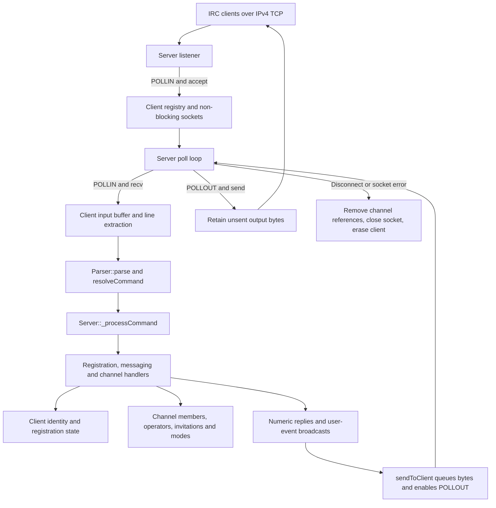
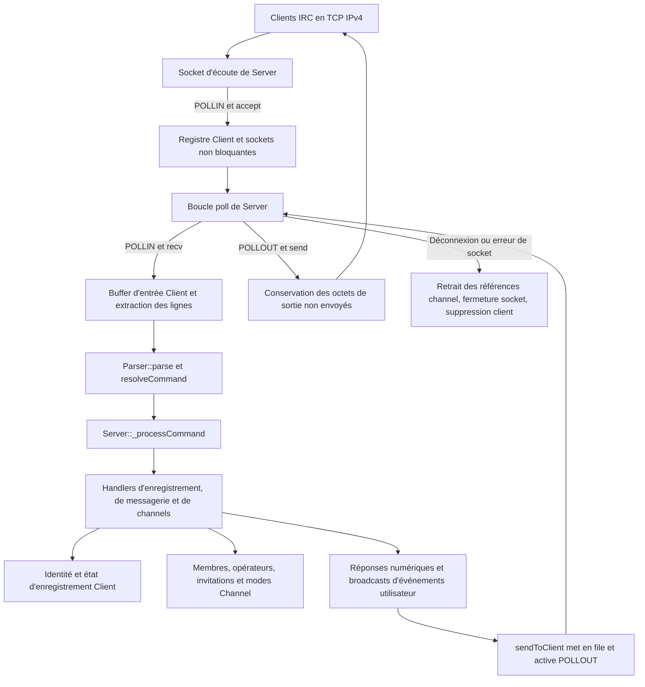

*Developed as part of the École 42 Paris curriculum.*

# ft_irc

**An event-driven IRC server in C++98: non-blocking TCP sockets, buffered messaging and stateful channel permissions in a single-threaded event loop.**

[English](#english) | [Français](#francais)

<!-- Future shared demo: add irc.gif at the repository root, then replace this comment with . -->
---

<a id="english"></a>
## English

[Project Context](#en-context) · [Overview](#en-overview) · [Features](#en-features) · [Engineering Highlights](#en-engineering) · [Architecture](#en-architecture) · [Getting Started](#en-start) · [Usage Examples](#en-examples)

<a id="en-context"></a>
### 1. Project Context

ft_irc belongs to the École 42 Paris common core curriculum, a project-based, peer-learning programme. Its objective is to build an IRC server that supports text communication between multiple users connected over TCP, implementing the network and protocol machinery rather than relying on an existing IRC server library.

The project brings together **low-level network programming, TCP/IP sockets, simultaneous connection management, event-driven I/O, object-oriented C++ design and application-state management**. In this implementation, a single event loop coordinates network readiness, client registration, message routing and channel permissions without threads or child processes.

The project is credited to **adecauch, ramahrez and anturtsc**. The existing project documentation records Claude assistance with robustness review and fixes, message prefixes, test preparation and documentation; it does not establish an individual division of implementation responsibilities.

<a id="en-overview"></a>
### 2. Overview

IRC means **Internet Relay Chat**, a text-based protocol in which clients send commands to a server to register an identity, exchange private messages and participate in shared channels. Its line-oriented messages make the protocol readable while exposing concrete network challenges: stream framing, connection lifecycle and state changes affecting several recipients.

ft_irc accepts IPv4 TCP connections, assembles incoming bytes into command lines, parses their parameters and dispatches them to dedicated handlers. Once registered with `PASS`, `NICK` and `USER`, users can message each other, create or join `#channels`, manage topics and apply channel-operator permissions.

The central engineering challenge is maintaining **consistent client and channel state while servicing multiple sockets**. `poll()` reports which sockets need attention; non-blocking reads and buffered writes share one thread, so waiting for activity does not require a worker per connection. The implemented command subset is detailed below, rather than presented as full IRC RFC compliance.

<a id="en-features"></a>
### 3. Features

| Area | Implemented scope |
|---|---|
| Networking | IPv4 TCP listener, `SO_REUSEADDR`, non-blocking listener/client sockets, one `poll()` loop; up to 512 tracked clients |
| Stream handling | Per-client input/output buffers; CRLF framing with LF fallback; fragmented and concatenated command handling; partial-write retention |
| Registration | `PASS`, `NICK`, `USER` in any order; password check, nickname validation and case-insensitive uniqueness; welcome numerics `001`–`004` |
| Messaging | `PRIVMSG` to one nickname or one channel; channel membership required; channel delivery excludes the sender |
| Channels | `JOIN`, `PART`, `TOPIC`, `KICK`, `INVITE`, `MODE`; creator becomes operator; topic and member-list replies on join; empty channels removed |
| Permissions | Invite-only access, operator-restricted topics, channel keys, operator grants/removals and member limits |
| Protocol processing | Uppercase command normalization, space-separated parameters and trailing `:text`; numeric replies for registration, target, parameter and permission errors |
| Session lifecycle | Nickname-change and quit broadcasts to shared-channel peers, client-initiated `PING` replies, accepted `PONG`; disconnect cleanup |
| Shutdown | `SIGINT`/`SIGQUIT` request loop termination; socket closure in server cleanup; `SIGPIPE` ignored |

| Channel mode | Effect | Example |
|---|---|---|
| `+i` / `-i` | Enable / disable invitation-only entry | `MODE #lobby +i` |
| `+t` / `-t` | Restrict / open topic changes to operators / all members | `MODE #lobby +t` |
| `+k` / `-k` | Set / remove a channel key | `MODE #lobby +k roomkey` |
| `+o` / `-o` | Grant / remove operator status for an existing member | `MODE #lobby +o Bob` |
| `+l` / `-l` | Set / remove a positive member limit | `MODE #lobby +l 10` |

`CAP` is accepted without capability negotiation. After registration, `NOTICE`, `WHO` and `WHOIS` are recognized but ignored: they do not deliver notifications or return query results. Use one channel per `JOIN`, `PART` or `KICK` and one recipient per `PRIVMSG`; comma-separated multi-target operation is not provided. The repository contains no bot or file-transfer implementation.

<a id="en-engineering"></a>
### 4. Engineering Highlights

#### Scheduling socket work through one readiness loop

A multi-client server must distinguish new connections from readable clients and pending writes without waiting on one socket at the expense of the others. `Server::start()` monitors a `std::vector<pollfd>` with `poll(..., -1)`: the listener stays in its first entry, while accepted clients are added with `POLLIN`. `_acceptNewConnection()` sets each accepted socket to `O_NONBLOCK` and stores a `Client` in the descriptor-indexed registry.

The loop handles `POLLHUP`, `POLLERR` and `POLLNVAL` before client I/O, then routes `POLLIN` to `_readClientData()` and `POLLOUT` to `_writeClientData()`. Removing a client also removes its polling entry; the loop adjusts its index after read-side disconnection to account for the shifted vector. Exceptions during client handling are caught at the connection boundary and trigger that client's cleanup.

This concentrates connection scheduling in one place and keeps command handlers independent of readiness checks. `accept()`, `recv()` and `send()` are reached through their corresponding readiness paths, without adding threads or child processes.

Sources: [event loop and socket setup](src/Server.cpp), [server state and interfaces](include/Server.hpp).

#### Reconstructing command lines and retaining unsent bytes

**TCP transports a byte stream: one IRC command is not necessarily one `recv()`.** `_readClientData()` appends up to 1,024 received bytes to the client's persistent input buffer, then repeatedly calls `Client::extractNextLine()`. That method removes complete CRLF-delimited lines, with LF accepted as a fallback; an incomplete suffix stays buffered for the next readable event. Several commands received together therefore take the same processing path as commands split across reads.

An unfinished line exceeding 8,192 buffered bytes is dropped with numeric `417`. `markLineOversized()` enters a discard state, and `resyncAfterOversizedLine()` skips through the next newline before normal parsing resumes. This bounds the pending fragment and prevents its remaining bytes from being mistaken for the start of another command; it is not a general RFC line-length validator.

On output, `sendToClient()` only appends bytes and enables `POLLOUT`. `_writeClientData()` performs the actual `send()` and removes **only the returned byte count**, preserving a partially sent suffix. Once the queue is empty, it disables `POLLOUT`, avoiding repeated wakeups for an idle writable socket. Negative read/write results lead to disconnection rather than an `errno`-based retry path.

Sources: [input extraction and output-buffer operations](src/Client.cpp), [buffer state](include/Client.hpp), [read/write scheduling](src/Server.cpp).

#### Separating protocol parsing, command resolution and execution

A line must preserve message text containing spaces while still exposing the command and its positional parameters. `Parser::parse()` skips leading spaces and an optional incoming prefix, uppercases the command, and stores parameters in `IrcMessage::params`. A parameter starting with `:` consumes the remaining text as one value, including spaces or an empty string. This supports both `PRIVMSG #lobby :Hello everyone` and `TOPIC #lobby :` without command-specific tokenizers.

`resolveCommand()` maps the normalized word through a fixed table of 17 recognized commands to `e_command`. `Server::_processCommand()` then selects dedicated `Server` member-function handlers, grouped into registration, messaging and channel source files. Unknown nonempty commands receive `421`; blank lines are ignored. Parsing remains separate from semantic checks such as missing parameters, unknown targets and insufficient permissions.

Replies use the shared definitions in `NumericReplies.hpp`, while relayed user events use `Client::getPrefix()` to construct `nick!user@host`, with the host taken from the accepted peer's IPv4 address. Outgoing messages end in CRLF. Centralized reply construction gives handlers consistent numeric/error vocabulary without claiming complete RFC coverage.

Sources: [message representation](include/Parser.hpp), [parser](src/Parser.cpp), [command table](src/commands/commands.cpp), [dispatch](src/Server.cpp), [numeric replies](include/NumericReplies.hpp), [user prefixes](src/Client.cpp).

#### Distinguishing a TCP connection from a registered user

Accepting a socket does not immediately authorize chat commands. A new `Client` starts with nickname `*`, an empty username and separate password-accepted and registered flags. Each successful `PASS`, `NICK` or `USER` invokes `_tryCompleteRegistration()`, which checks all three prerequisites before setting the registered flag and queuing `001`–`004` exactly once. This makes registration independent of the order in which those commands arrive.

Nickname validation limits the full nickname to nine characters: a leading letter followed by the allowed alphanumeric/special characters. Uniqueness checks compare letters without case and exclude the requesting descriptor, so a client does not collide with itself. After registration, a rename is broadcast with the **old identity in the prefix**, allowing peers to associate the change with the existing user.

The dispatcher lets handshake/session commands through before checking registration; channel and messaging operations pass through a shared registration gate and otherwise receive `451`. Keeping that gate in the dispatcher avoids duplicating the connection-versus-user distinction across every handler.

Sources: [initial client state](src/Client.cpp), [registration handlers and completion gate](src/commands/Registration.cpp), [central dispatch](src/Server.cpp).

#### Expressing channel access rules as channel-owned state

Channel permissions must remain coherent as users join, leave and change roles. `Channel` encapsulates the topic, mode flags, optional key/limit and three `std::set<int>` collections for members, operators and invited descriptors. These sets avoid duplicate entries while keeping channel-specific roles separate from a client's identity and I/O buffers.

`_handleJoin()` creates a missing channel and grants its creator operator status. For an existing channel it checks invitation, key and capacity before inserting the new member; a successful join consumes the invitation. An invitation does not bypass the key or member limit. Channel lookup compares names without case while preserving the spelling stored at creation.

`_handleMode()` requires membership for inspection and operator status for modification. `_applyModeChanges()` walks the mode string left to right, tracks the current `+`/`-` sign and consumes the relevant key, nickname or limit arguments. `TOPIC` changes require operator status only under `+t`; `INVITE` requires it only under `+i`; `KICK` always requires it. Successful mode operations are collected into a broadcast so members receive the applied changes together.

Sources: [channel model](include/Channel.hpp), [channel state operations](src/Channel.cpp), [join, mode and permission handlers](src/commands/Channels.cpp).

#### Coordinating broadcasts and descriptor lifetimes in C++98

One user can share several channels with the same peer, so broadcasting separately to each channel would duplicate `NICK` and `QUIT` events. `_broadcastToPeers()` first collects recipients in a `std::set<int>`, then queues one message per descriptor. Channel `PRIVMSG` instead uses `_broadcastToChannel()` with the sender excluded; membership events such as `JOIN`, `PART` and `KICK` include the affected client so its local view can update.

`_disconnectClient()` broadcasts the departure before removing membership, then clears the descriptor from every channel's member, operator **and invitation** sets. Purging invitations matters because the operating system can reuse a closed descriptor for a different connection. Empty channels are erased, the socket is closed, and the polling/client entries are removed.

The server stores `Client` and `Channel` objects by value in `std::map`, with STL-managed strings and collections rather than separately allocated client/channel objects. Socket closure remains `Server`'s responsibility, not `Client`'s destructor. At shutdown, signal handlers request loop termination; the `Server` destructor calls `stop()` outside the signal handler to close sockets. This makes the distinction between application data and operating-system resources visible in the object model.

Sources: [broadcasts and channel removal](src/commands/Channels.cpp), [disconnect and shutdown lifecycle](src/Server.cpp), [value-owned registries](include/Server.hpp), [signal setup](src/main.cpp).

<a id="en-architecture"></a>
### 5. Architecture

`Server` owns the listening socket, polling entries and client/channel registries. `Client` holds identity, registration flags and byte buffers; `Channel` holds membership and access policy. `Parser` is a **namespace**, not a class, and returns an `IrcMessage` structure. Command handlers are `Server` methods organized by responsibility, not separate command objects.



The diagram shows the normal connection and message paths. Complete buffered lines are dispatched in sequence; handlers queue replies rather than writing directly to sockets.

```text
Makefile                       C++98 build and cleanup targets
include/Server.hpp             Socket lifecycle, registries and handler interfaces
include/Client.hpp             Identity, registration flags and I/O buffers
include/Channel.hpp            Membership, operators, invitations, topic and modes
include/Parser.hpp             IrcMessage and parsing interface
include/commands.hpp           Command names, enumeration and resolver declaration
include/NumericReplies.hpp     Shared numeric reply/error definitions
src/main.cpp                   Argument validation and signal configuration
src/Server.cpp                 Socket setup, poll loop, dispatch, I/O and cleanup
src/Client.cpp                 Buffer framing, prefix construction and client state
src/Channel.cpp                Channel state operations
src/Parser.cpp                 Command and parameter extraction
src/commands/commands.cpp      Recognized-command lookup table
src/commands/Registration.cpp  PASS, NICK, USER and registration completion
src/commands/Messaging.cpp     Nickname lookup and PRIVMSG routing
src/commands/Channels.cpp      Channel commands, permissions and broadcast helpers
```

<a id="en-start"></a>
### 6. Getting Started

**Requirements:** a Unix-like environment providing POSIX sockets, `poll`, `fcntl` and `sigaction` (such as Linux or macOS), Make and a C++98-capable `c++` compiler. No third-party server library is required. The [Makefile](Makefile) uses `-Wall -Wextra -Werror -std=c++98 -Iinclude` and builds `ircserv`.

From the repository root, in a terminal:

```bash
make
./ircserv 6667 demo-pass
```

The syntax is `./ircserv <port> <password>`, with a decimal port from `1` to `65535`; use an available unprivileged port such as `6667`. `demo-pass` is a fictitious demonstration password.

**Network scope:** the listener binds to `INADDR_ANY` (all IPv4 interfaces), not just loopback. Run demonstrations on an isolated local machine/VM or restrict access with your firewall; connecting to `127.0.0.1` does not change the listener's scope. Connections use plain TCP, without TLS.

With [Irssi](https://irssi.org/) installed separately, open a second terminal:

```bash
irssi -c 127.0.0.1 -p 6667 -w demo-pass -n Alice
```

Inside Irssi, commands start with `/`, for example `/join #lobby` or `/msg Bob Hello`. The examples below use raw IRC commands instead, keeping the protocol separate from the client interface.

For an interactive raw connection with netcat:

```bash
nc 127.0.0.1 6667
```

Type the registration lines from the next section. The server accepts LF-terminated netcat input as well as IRC's CRLF. For a CRLF-framed, one-shot registration and ping from a shell:

```bash
printf 'PASS demo-pass\r\nNICK Probe\r\nUSER probe 0 * :Protocol probe\r\nPING :check\r\n' | nc -w 2 127.0.0.1 6667
```

Stop the server with **Ctrl+C** (`SIGINT`) or **Ctrl+\** (`SIGQUIT`) in its terminal. Shutdown closes the listening and client sockets.

```bash
make clean      # Remove .o files next to the sources
make fclean     # Also remove ircserv
make re         # Full cleanup, then rebuild
```

<a id="en-examples"></a>
### 7. Usage Examples

Start the server as above, then open **two separate netcat connections**, one for Alice and one for Bob:

```bash
nc 127.0.0.1 6667
```

The following blocks are **raw IRC input**, not shell commands or Irssi slash commands. Send them in the indicated connection and order. For a raw protocol client, terminate every line with CRLF; interactive netcat can use the server's LF fallback.

**1. Register Alice and create a channel** — enter in Alice's connection first. As creator, Alice becomes its operator.

```text
PASS demo-pass
NICK Alice
USER alice 0 * :Alice Example
JOIN #lobby
TOPIC #lobby :Network programming at 42
```

**2. Register Bob and join the same channel** — enter in Bob's connection after Alice's join.

```text
PASS demo-pass
NICK Bob
USER bob 0 * :Bob Example
JOIN #lobby
PRIVMSG #lobby :Hello Alice, I joined the channel.
PRIVMSG Alice :This message is private.
```

**3. Reply and manage permissions** — enter in Alice's connection. The channel message goes to Bob; the private reply targets Bob directly. Topic restriction, operator status and a member limit are separate mode changes.

```text
PRIVMSG #lobby :Welcome to the channel.
PRIVMSG Bob :Private reply received.
MODE #lobby +t
MODE #lobby +o Bob
MODE #lobby +l 10
MODE #lobby
```

**4. Demonstrate invitation-only entry and a channel key** — Alice first enables both restrictions:

```text
MODE #lobby +i
MODE #lobby +k roomkey
```

Bob leaves, losing his channel-operator role:

```text
PART #lobby :Trying the invitation flow
```

Alice then invites him back:

```text
INVITE Bob #lobby
```

Bob rejoins with the key; the invitation is consumed, and he returns as a regular member:

```text
JOIN #lobby roomkey
```

**5. Remove a member and close both sessions** — Alice can kick Bob while remaining in the channel:

```text
KICK #lobby Bob :End of demonstration
```

Bob ends his TCP session with:

```text
QUIT :Goodbye
```

Alice leaves last, removing the now-empty channel, then disconnects:

```text
PART #lobby :Closing the channel
QUIT :Goodbye
```

---

<a id="francais"></a>
## Français

[Contexte du projet](#fr-contexte) · [Présentation](#fr-presentation) · [Fonctionnalités](#fr-fonctionnalites) · [Points techniques](#fr-technique) · [Architecture](#fr-architecture) · [Installation et lancement](#fr-installation) · [Exemples d'utilisation](#fr-exemples)

<a id="fr-contexte"></a>
### 1. Contexte du projet

ft_irc s'inscrit dans le tronc commun de l'École 42 Paris, une formation par projets et apprentissage entre pairs. Son objectif est de développer un serveur IRC permettant à plusieurs utilisateurs connectés en TCP de communiquer par texte, en implémentant les mécanismes réseau et protocolaires plutôt qu'en utilisant une bibliothèque de serveur IRC existante.

Le projet mobilise la **programmation réseau bas niveau, les sockets TCP/IP, la gestion de connexions simultanées, les entrées/sorties événementielles, la conception orientée objet en C++ et la gestion de l'état applicatif**. Dans cette implémentation, une seule boucle événementielle coordonne la disponibilité réseau, l'enregistrement des clients, le routage des messages et les permissions des channels, sans threads ni processus enfants.

Le projet est crédité à **adecauch, ramahrez et anturtsc**. La documentation existante du projet mentionne une assistance de Claude pour la relecture et les corrections de robustesse, les préfixes des messages, la préparation des tests et la documentation ; elle n'établit pas de répartition individuelle des responsabilités d'implémentation.

<a id="fr-presentation"></a>
### 2. Présentation

IRC signifie **Internet Relay Chat** : un protocole textuel dans lequel les clients envoient des commandes à un serveur pour enregistrer une identité, échanger des messages privés et participer à des channels communs. Ses messages organisés en lignes rendent le protocole lisible tout en soulevant des difficultés réseau concrètes : délimitation d'un flux, cycle de vie des connexions et changements d'état concernant plusieurs destinataires.

ft_irc accepte des connexions TCP IPv4, assemble les octets reçus en lignes de commande, analyse leurs paramètres et les distribue à des handlers dédiés. Après leur enregistrement avec `PASS`, `NICK` et `USER`, les utilisateurs peuvent s'envoyer des messages, créer ou rejoindre des `#channels`, gérer les sujets et appliquer des permissions d'opérateur de channel.

La difficulté technique centrale consiste à maintenir **la cohérence de l'état des clients et des channels tout en traitant plusieurs sockets**. `poll()` indique les sockets qui demandent une intervention ; les lectures non bloquantes et les écritures bufferisées partagent un seul thread, sans nécessiter un worker par connexion pour attendre l'activité. Le sous-ensemble de commandes implémenté est détaillé ci-dessous, sans être présenté comme une conformité intégrale aux RFC IRC.

<a id="fr-fonctionnalites"></a>
### 3. Fonctionnalités

| Domaine | Périmètre implémenté |
|---|---|
| Réseau | Socket d'écoute TCP IPv4, `SO_REUSEADDR`, sockets d'écoute/clientes non bloquantes, une boucle `poll()` ; jusqu'à 512 clients suivis |
| Gestion du flux | Buffers d'entrée/sortie par client ; délimitation CRLF avec repli sur LF ; traitement des commandes fragmentées ou concaténées ; conservation des écritures partielles |
| Enregistrement | `PASS`, `NICK`, `USER` dans n'importe quel ordre ; vérification du mot de passe, validation et unicité des pseudos sans distinction de casse ; réponses d'accueil `001`–`004` |
| Messagerie | `PRIVMSG` vers un pseudo ou un channel ; appartenance au channel obligatoire ; diffusion au channel sans renvoi à l'émetteur |
| Channels | `JOIN`, `PART`, `TOPIC`, `KICK`, `INVITE`, `MODE` ; créateur promu opérateur ; réponses de sujet et liste des membres à l'entrée ; suppression des channels vides |
| Permissions | Accès sur invitation, sujet réservé aux opérateurs, clés de channel, attribution/retrait du statut d'opérateur et limites de membres |
| Traitement du protocole | Normalisation des commandes en majuscules, paramètres séparés par des espaces et dernier paramètre `:texte` ; réponses numériques pour les erreurs d'enregistrement, de cible, de paramètres et de permissions |
| Cycle de session | Broadcast des changements de pseudo et départs aux pairs partageant un channel, réponse aux `PING` des clients, acceptation de `PONG` ; nettoyage à la déconnexion |
| Arrêt | `SIGINT`/`SIGQUIT` demandent la sortie de boucle ; fermeture des sockets lors du nettoyage du serveur ; `SIGPIPE` ignoré |

| Mode de channel | Effet | Exemple |
|---|---|---|
| `+i` / `-i` | Activer / désactiver l'entrée sur invitation | `MODE #lobby +i` |
| `+t` / `-t` | Réserver le changement de sujet aux opérateurs / l'ouvrir à tous les membres | `MODE #lobby +t` |
| `+k` / `-k` | Définir / retirer une clé de channel | `MODE #lobby +k roomkey` |
| `+o` / `-o` | Attribuer / retirer le statut d'opérateur à un membre existant | `MODE #lobby +o Bob` |
| `+l` / `-l` | Définir / retirer une limite positive de membres | `MODE #lobby +l 10` |

`CAP` est acceptée sans négociation de capacités. Après l'enregistrement, `NOTICE`, `WHO` et `WHOIS` sont reconnues mais ignorées : elles ne transmettent pas de notifications et ne renvoient pas de résultats de requête. Utilisez un seul channel par `JOIN`, `PART` ou `KICK` et un seul destinataire par `PRIVMSG` ; les opérations multicibles séparées par des virgules ne sont pas proposées. Le dépôt ne contient pas d'implémentation de bot ni de transfert de fichiers.

<a id="fr-technique"></a>
### 4. Points techniques

#### Orchestrer les sockets dans une seule boucle de disponibilité

Un serveur multiclient doit distinguer les nouvelles connexions, les clients lisibles et les écritures en attente sans bloquer sur une socket au détriment des autres. `Server::start()` surveille un `std::vector<pollfd>` avec `poll(..., -1)` : la socket d'écoute reste en première position, tandis que les clients acceptés sont ajoutés avec `POLLIN`. `_acceptNewConnection()` configure chaque socket acceptée en `O_NONBLOCK` et conserve un `Client` dans le registre indexé par descripteur.

La boucle traite `POLLHUP`, `POLLERR` et `POLLNVAL` avant les entrées/sorties clientes, puis dirige `POLLIN` vers `_readClientData()` et `POLLOUT` vers `_writeClientData()`. Retirer un client supprime aussi son entrée de surveillance ; après une déconnexion côté lecture, la boucle ajuste son indice pour tenir compte du décalage du vecteur. Les exceptions pendant le traitement d'un client sont interceptées à l'échelle de la connexion et déclenchent son nettoyage.

Cette approche concentre l'orchestration des connexions à un seul endroit et rend les handlers de commandes indépendants des vérifications de disponibilité. `accept()`, `recv()` et `send()` sont appelés par les chemins correspondant à leurs événements, sans ajouter de threads ni de processus enfants.

Sources : [boucle événementielle et configuration des sockets](src/Server.cpp), [état et interfaces du serveur](include/Server.hpp).

#### Reconstituer les lignes de commande et conserver les octets non envoyés

**TCP transporte un flux d'octets : une commande IRC ne correspond pas nécessairement à un `recv()`.** `_readClientData()` ajoute jusqu'à 1 024 octets reçus au buffer d'entrée persistant du client, puis appelle `Client::extractNextLine()` en boucle. Cette méthode retire les lignes complètes délimitées par CRLF, avec LF accepté en repli ; un suffixe incomplet reste en mémoire jusqu'au prochain événement de lecture. Plusieurs commandes reçues ensemble suivent ainsi le même traitement que des commandes réparties sur plusieurs lectures.

Une ligne inachevée dépassant 8 192 octets bufferisés est abandonnée avec la réponse numérique `417`. `markLineOversized()` active un état de rejet, et `resyncAfterOversizedLine()` ignore les octets jusqu'au prochain saut de ligne avant de reprendre le parsing normal. Cela borne le fragment en attente et évite de confondre ses octets restants avec le début d'une autre commande ; ce mécanisme n'est pas un validateur général de longueur de ligne RFC.

En sortie, `sendToClient()` se contente d'ajouter les octets et d'activer `POLLOUT`. `_writeClientData()` effectue le véritable `send()` et ne retire **que le nombre d'octets retourné**, en conservant le suffixe partiellement envoyé. Une fois la file vide, elle désactive `POLLOUT` pour éviter des réveils répétés sur une socket disponible en écriture mais sans travail. Les résultats négatifs en lecture/écriture entraînent une déconnexion plutôt qu'une nouvelle tentative pilotée par `errno`.

Sources : [extraction des lignes et opérations sur le buffer de sortie](src/Client.cpp), [état des buffers](include/Client.hpp), [orchestration des lectures/écritures](src/Server.cpp).

#### Séparer parsing du protocole, résolution des commandes et exécution

Une ligne doit préserver un message contenant des espaces tout en exposant la commande et ses paramètres positionnels. `Parser::parse()` ignore les espaces initiaux et un éventuel préfixe entrant, met la commande en majuscules et stocke les paramètres dans `IrcMessage::params`. Un paramètre commençant par `:` absorbe tout le texte restant en une seule valeur, espaces compris, éventuellement vide. Cela permet de traiter `PRIVMSG #lobby :Hello everyone` comme `TOPIC #lobby :` sans tokenizer propre à chaque commande.

`resolveCommand()` traduit le mot normalisé en `e_command` grâce à une table fixe de 17 commandes reconnues. `Server::_processCommand()` sélectionne ensuite des handlers dédiés, méthodes membres de `Server`, regroupés dans les fichiers d'enregistrement, de messagerie et de channels. Une commande inconnue non vide reçoit `421` ; les lignes vides sont ignorées. Le parsing reste distinct des vérifications sémantiques : paramètres manquants, cible inconnue ou permissions insuffisantes.

Les réponses utilisent les définitions partagées de `NumericReplies.hpp`, tandis que les événements utilisateur relayés passent par `Client::getPrefix()` pour construire `nick!user@host`, avec l'adresse IPv4 du pair accepté comme hôte. Les messages sortants se terminent par CRLF. La construction centralisée des réponses fournit aux handlers un vocabulaire cohérent de codes numériques et d'erreurs, sans revendiquer une couverture complète des RFC.

Sources : [représentation des messages](include/Parser.hpp), [parser](src/Parser.cpp), [table des commandes](src/commands/commands.cpp), [dispatch](src/Server.cpp), [réponses numériques](include/NumericReplies.hpp), [préfixes utilisateur](src/Client.cpp).

#### Distinguer connexion TCP et utilisateur enregistré

Accepter une socket n'autorise pas immédiatement les commandes de discussion. Un nouveau `Client` commence avec le pseudo `*`, un username vide et deux drapeaux distincts pour le mot de passe accepté et l'enregistrement. Chaque `PASS`, `NICK` ou `USER` réussi appelle `_tryCompleteRegistration()`, qui vérifie les trois prérequis avant d'activer le drapeau d'enregistrement et de mettre en file `001`–`004` une seule fois. L'enregistrement est ainsi indépendant de l'ordre d'arrivée de ces commandes.

La validation limite le pseudo complet à neuf caractères : une lettre initiale suivie des caractères alphanumériques ou spéciaux autorisés. La vérification d'unicité compare les lettres sans distinction de casse et exclut le descripteur demandeur, pour qu'un client n'entre pas en collision avec lui-même. Après l'enregistrement, un changement de pseudo est diffusé avec **l'ancienne identité en préfixe**, afin que les pairs puissent rattacher ce changement à l'utilisateur existant.

Le dispatcher laisse passer les commandes de handshake et de session avant de vérifier l'enregistrement ; les opérations de channel et de messagerie traversent une barrière commune et reçoivent sinon `451`. Placer cette vérification dans le dispatcher évite de dupliquer la distinction entre connexion et utilisateur dans chaque handler.

Sources : [état initial du client](src/Client.cpp), [handlers d'enregistrement et vérification de complétion](src/commands/Registration.cpp), [dispatch central](src/Server.cpp).

#### Représenter les règles d'accès dans l'état propre au channel

Les permissions d'un channel doivent rester cohérentes lorsque les utilisateurs arrivent, partent ou changent de rôle. `Channel` encapsule le sujet, les drapeaux de modes, la clé et la limite optionnelles, ainsi que trois collections `std::set<int>` pour les membres, les opérateurs et les descripteurs invités. Ces ensembles évitent les doublons tout en séparant les rôles propres au channel de l'identité et des buffers d'entrée/sortie du client.

`_handleJoin()` crée un channel absent et attribue le statut d'opérateur à son créateur. Pour un channel existant, elle vérifie l'invitation, la clé et la capacité avant d'insérer le nouveau membre ; une entrée réussie consomme l'invitation. Une invitation ne contourne ni la clé ni la limite de membres. La recherche des channels compare les noms sans distinction de casse tout en conservant l'orthographe enregistrée à la création.

`_handleMode()` exige d'être membre pour consulter les modes, et opérateur pour les modifier. `_applyModeChanges()` parcourt la chaîne de modes de gauche à droite, mémorise le signe `+`/`-` courant et consomme les arguments de clé, de pseudo ou de limite correspondants. Modifier `TOPIC` n'exige le statut d'opérateur que sous `+t` ; `INVITE` ne l'exige que sous `+i` ; `KICK` l'exige toujours. Les opérations de mode réussies sont regroupées dans un broadcast pour que les membres reçoivent ensemble les changements appliqués.

Sources : [modèle de channel](include/Channel.hpp), [opérations sur l'état du channel](src/Channel.cpp), [handlers d'entrée, de modes et de permissions](src/commands/Channels.cpp).

#### Coordonner broadcasts et durée de vie des descripteurs en C++98

Un utilisateur peut partager plusieurs channels avec le même pair : diffuser séparément sur chacun produirait donc des doublons pour `NICK` et `QUIT`. `_broadcastToPeers()` rassemble d'abord les destinataires dans un `std::set<int>`, puis met un seul message en file par descripteur. Un `PRIVMSG` de channel utilise plutôt `_broadcastToChannel()` en excluant l'émetteur ; les événements d'appartenance comme `JOIN`, `PART` et `KICK` incluent le client concerné pour qu'il actualise sa vue locale.

`_disconnectClient()` diffuse le départ avant de retirer l'appartenance aux channels, puis efface le descripteur des ensembles de membres, d'opérateurs **et d'invitations** de chaque channel. Purger les invitations est important car le système d'exploitation peut réutiliser un descripteur fermé pour une autre connexion. Les channels vides sont supprimés, la socket est fermée, et les entrées de surveillance et de client sont retirées.

Le serveur conserve les objets `Client` et `Channel` par valeur dans des `std::map`, avec des chaînes et collections gérées par la STL plutôt que des objets clients/channels alloués séparément. La fermeture des sockets reste la responsabilité de `Server`, pas du destructeur de `Client`. À l'arrêt, les handlers de signaux demandent la sortie de boucle ; le destructeur de `Server` appelle `stop()` hors du handler pour fermer les sockets. Cette organisation rend visible la distinction entre données applicatives et ressources du système d'exploitation dans le modèle objet.

Sources : [broadcasts et retrait des channels](src/commands/Channels.cpp), [cycle de déconnexion et d'arrêt](src/Server.cpp), [registres d'objets par valeur](include/Server.hpp), [configuration des signaux](src/main.cpp).

<a id="fr-architecture"></a>
### 5. Architecture

`Server` possède la socket d'écoute, les entrées de surveillance et les registres de clients/channels. `Client` conserve l'identité, les drapeaux d'enregistrement et les buffers d'octets ; `Channel` conserve les membres et les règles d'accès. `Parser` est un **namespace**, pas une classe, et renvoie une structure `IrcMessage`. Les handlers sont des méthodes de `Server` organisées par responsabilité, pas des objets de commande distincts.



Le diagramme décrit les chemins normaux de connexion et de messagerie. Les lignes complètes bufferisées sont distribuées dans l'ordre ; les handlers mettent les réponses en file plutôt que d'écrire directement sur les sockets.

```text
Makefile                       Compilation C++98 et cibles de nettoyage
include/Server.hpp             Cycle des sockets, registres et interfaces des handlers
include/Client.hpp             Identité, drapeaux d'enregistrement et buffers d'E/S
include/Channel.hpp            Membres, opérateurs, invitations, sujet et modes
include/Parser.hpp             IrcMessage et interface de parsing
include/commands.hpp           Noms de commandes, énumération et déclaration du resolver
include/NumericReplies.hpp     Définitions partagées des réponses/erreurs numériques
src/main.cpp                   Validation des arguments et configuration des signaux
src/Server.cpp                 Sockets, boucle poll, dispatch, E/S et nettoyage
src/Client.cpp                 Délimitation des lignes, préfixes et état client
src/Channel.cpp                Opérations sur l'état des channels
src/Parser.cpp                 Extraction des commandes et paramètres
src/commands/commands.cpp      Table de résolution des commandes reconnues
src/commands/Registration.cpp  PASS, NICK, USER et finalisation de l'enregistrement
src/commands/Messaging.cpp     Recherche par pseudo et routage de PRIVMSG
src/commands/Channels.cpp      Commandes de channel, permissions et helpers de broadcast
```

<a id="fr-installation"></a>
### 6. Installation et lancement

**Prérequis :** un environnement de type Unix proposant les sockets POSIX, `poll`, `fcntl` et `sigaction` (comme Linux ou macOS), Make et un compilateur `c++` compatible C++98. Aucune bibliothèque serveur tierce n'est nécessaire. Le [Makefile](Makefile) utilise `-Wall -Wextra -Werror -std=c++98 -Iinclude` et produit `ircserv`.

Depuis la racine du dépôt, dans un terminal :

```bash
make
./ircserv 6667 demo-pass
```

La syntaxe est `./ircserv <port> <password>`, avec un port décimal entre `1` et `65535` ; choisissez un port non privilégié disponible comme `6667`. `demo-pass` est un mot de passe fictif de démonstration.

**Périmètre réseau :** la socket d'écoute est liée à `INADDR_ANY` (toutes les interfaces IPv4), pas seulement à la boucle locale. Effectuez les démonstrations sur une machine/VM locale isolée ou restreignez les accès avec votre pare-feu ; se connecter à `127.0.0.1` ne change pas le périmètre d'écoute. Les connexions utilisent TCP en clair, sans TLS.

Avec [Irssi](https://irssi.org/) installé séparément, ouvrez un deuxième terminal :

```bash
irssi -c 127.0.0.1 -p 6667 -w demo-pass -n Alice
```

Dans Irssi, les commandes commencent par `/`, par exemple `/join #lobby` ou `/msg Bob Hello`. Les exemples suivants utilisent plutôt des commandes IRC brutes pour distinguer le protocole de l'interface du client.

Pour une connexion brute interactive avec netcat :

```bash
nc 127.0.0.1 6667
```

Saisissez les lignes d'enregistrement de la section suivante. Le serveur accepte les entrées netcat terminées par LF, en plus du CRLF d'IRC. Pour un enregistrement et un ping ponctuels délimités par CRLF depuis un shell :

```bash
printf 'PASS demo-pass\r\nNICK Probe\r\nUSER probe 0 * :Protocol probe\r\nPING :check\r\n' | nc -w 2 127.0.0.1 6667
```

Arrêtez le serveur avec **Ctrl+C** (`SIGINT`) ou **Ctrl+\** (`SIGQUIT`) dans son terminal. L'arrêt ferme la socket d'écoute et les sockets clientes.

```bash
make clean      # Supprimer les .o à côté des sources
make fclean     # Supprimer aussi ircserv
make re         # Nettoyage complet, puis recompilation
```

<a id="fr-exemples"></a>
### 7. Exemples d'utilisation

Lancez le serveur comme ci-dessus, puis ouvrez **deux connexions netcat distinctes**, une pour Alice et une pour Bob :

```bash
nc 127.0.0.1 6667
```

Les blocs suivants sont des **entrées IRC brutes**, pas des commandes shell ni des commandes Irssi précédées de `/`. Envoyez-les dans la connexion et dans l'ordre indiqués. Pour un client protocolaire brut, terminez chaque ligne par CRLF ; netcat interactif peut utiliser le repli LF du serveur.

**1. Enregistrer Alice et créer un channel** — saisissez d'abord ces lignes dans la connexion d'Alice. En tant que créatrice, Alice devient opératrice du channel.

```text
PASS demo-pass
NICK Alice
USER alice 0 * :Alice Example
JOIN #lobby
TOPIC #lobby :Network programming at 42
```

**2. Enregistrer Bob et rejoindre le même channel** — saisissez ces lignes dans la connexion de Bob après l'entrée d'Alice.

```text
PASS demo-pass
NICK Bob
USER bob 0 * :Bob Example
JOIN #lobby
PRIVMSG #lobby :Hello Alice, I joined the channel.
PRIVMSG Alice :This message is private.
```

**3. Répondre et gérer les permissions** — saisissez ces lignes dans la connexion d'Alice. Le message de channel est transmis à Bob ; la réponse privée lui est adressée directement. La restriction du sujet, le statut d'opérateur et la limite de membres sont des changements de mode distincts.

```text
PRIVMSG #lobby :Welcome to the channel.
PRIVMSG Bob :Private reply received.
MODE #lobby +t
MODE #lobby +o Bob
MODE #lobby +l 10
MODE #lobby
```

**4. Démontrer l'accès sur invitation et la clé de channel** — Alice active d'abord les deux restrictions :

```text
MODE #lobby +i
MODE #lobby +k roomkey
```

Bob quitte le channel, perdant son rôle d'opérateur :

```text
PART #lobby :Trying the invitation flow
```

Alice le réinvite ensuite :

```text
INVITE Bob #lobby
```

Bob revient avec la clé ; l'invitation est consommée et il redevient un membre ordinaire :

```text
JOIN #lobby roomkey
```

**5. Retirer un membre et fermer les deux sessions** — Alice peut expulser Bob tout en restant dans le channel :

```text
KICK #lobby Bob :End of demonstration
```

Bob termine sa session TCP avec :

```text
QUIT :Goodbye
```

Alice part en dernier, ce qui supprime le channel désormais vide, puis se déconnecte :

```text
PART #lobby :Closing the channel
QUIT :Goodbye
```
